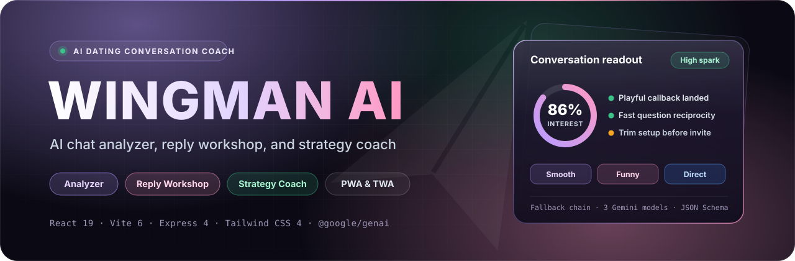
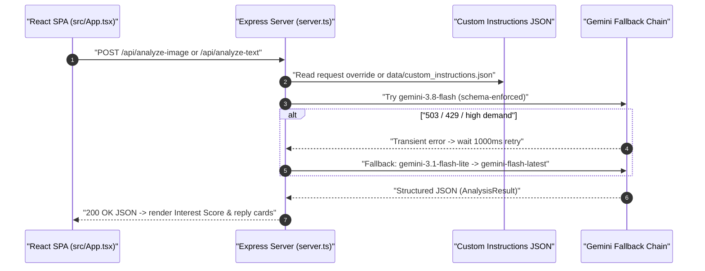

<p align="center">
  
</p>

<p align="center">
  
</p>

<p align="center">
  <a href="https://react.dev"></a>
  <a href="https://vite.dev"></a>
  <a href="https://expressjs.com"></a>
  <a href="https://www.typescriptlang.org"></a>
  <a href="https://tailwindcss.com"></a>
  <a href="https://ai.google.dev"></a>
</p>

**WingMan AI** is a fullstack AI dating conversation coach that turns uploaded chat screenshots or pasted transcripts into structured subtext analysis, calibrated reply suggestions, draft feedback, and multi-turn strategy advice. Built on React 19, Vite 6, Tailwind CSS 4, Express 4, and the `@google/genai` SDK with an installable PWA manifest and Google Play Trusted Web Activity (TWA) assets.

---

## Contents

- [Features](#features)
- [Architecture and Gemini fallback](#architecture-and-gemini-fallback)
- [API reference](#api-reference)
- [Getting started](#getting-started)
- [Environment variables](#environment-variables)
- [PWA and Android TWA support](#pwa-and-android-twa-support)
- [Scripts](#scripts)
- [Security and known limitations](#security-and-known-limitations)

---

## Features

| Surface | Component | Capabilities |
| :--- | :--- | :--- |
| **Chat analyzer** | `ConversationUpload` + `AnalysisDisplay` | Accepts screenshot upload, drag-and-drop, clipboard paste (`Ctrl+V`), or pasted text (`Ctrl+Enter`); lets users set message side (`Right` / `Left`) and tone (`Mix`, `Smooth`, `Funny`, `Direct`). Renders a radial Interest Score (`0–100%`), subtext readout, Green vs. Red signals, reconstructed transcript bubbles, and filterable reply cards. |
| **Reply workshop** | `ReplyWorkshop` | Freezes the latest conversation context alongside a draft composer, scores authenticity, flags try-hard phrasing vs. genuine moments, and returns refined rewrites (`POST /api/workshop-reply`). |
| **Strategy coach** | `StrategyCoach` | Multi-turn coaching chat seeded with starter prompts, sending conversation history to `POST /api/strategy-coach` with copyable tactical responses. |
| **Custom instructions** | `CustomInstructionsModal` | Four quick style presets (`Concise & punchy`, `Dry wit & banter`, `Direct & date-focused`, `Casual lowercase`) persisted to both `localStorage` (`wingman_custom_instructions`) and the server (`data/custom_instructions.json`). |
| **Responsive framing** | `App` + `Header` | Supports full-width desktop layout, a `390×780` Android smartphone frame simulator toggle on `sm+` viewports, and mobile bottom navigation (`AndroidBottomNav`). |

Under the hood:
- First-visit splash overlay (`sessionStorage` key `wingman_splash_seen`) and three-slide onboarding modal (`localStorage` key `wingman_welcome_seen`) honor `prefers-reduced-motion: reduce`.
- Every Gemini call injects user custom instructions via `buildSystemInstruction()` as a mandatory override block atop the core coaching prompt.

---

## Architecture and Gemini fallback

`server.ts` serves both the REST API and the frontend: Vite middleware in development (`NODE_ENV !== "production"`) and the compiled `dist/` static bundle in production. All Gemini calls flow through `generateWithFallback()`, enforcing structured JSON output (`ANALYSIS_SCHEMA` and `WORKSHOP_SCHEMA`) and retrying across a three-model fallback chain.



Model execution rules enforced in `server.ts`:
- `RELIABLE_MODELS` order: `gemini-3.8-flash` -> `gemini-3.1-flash-lite` -> `gemini-flash-latest`.
- Each model allows up to two attempts, pausing `1000ms` before retry when the response error matches `503`, `high demand`, or `429`.
- `safeParseJson()` strips Markdown code fences before `JSON.parse()` so UI rendering never breaks on fenced model output.

---

## API reference

All API endpoints are defined in `server.ts` with a `50mb` JSON and URL-encoded body limit to accommodate base64 screenshots.

| Method & path | Request payload | Response | Notes |
| :--- | :--- | :--- | :--- |
| `POST /api/analyze-image` | `{ images?, imageBase64?, mimeType?, userNote?, customInstructions? }` | `AnalysisResult` JSON | Accepts single `imageBase64` or an array of `images` (`inlineData` parts); returns `400` if no image is supplied. |
| `POST /api/analyze-text` | `{ conversationText, userNote?, customInstructions? }` | `AnalysisResult` JSON | Returns `400` when `conversationText` is missing. |
| `POST /api/workshop-reply` | `{ conversationContext, draftReply, customInstructions? }` | `WorkshopFeedback` JSON | Evaluates draft authenticity and returns `refinedOptions`; returns `400` if `draftReply` is missing. |
| `POST /api/strategy-coach` | `{ message, history?, customInstructions? }` | `{ reply: string }` | Maps `assistant` roles in `history` to Gemini `"model"` turns. |
| `GET /api/custom-instructions` | — | `{ instructions: string }` | Loads cached instructions or reads `data/custom_instructions.json`. |
| `POST /api/custom-instructions` | `{ instructions: string }` | `{ success: true, instructions }` | Trims and writes `data/custom_instructions.json` on disk. |
| `GET /api/health` | — | `{ status: "ok", app: "Rizzz" }` | Health check returning the legacy `"Rizzz"` identifier. |

Express also serves `GET /.well-known/assetlinks.json` (`application/json`) and `GET /manifest.webmanifest` (`application/manifest+json`) explicitly from `public/`.

---

## Getting started

### Prerequisites

- Node.js 20+ (LTS recommended) and npm
- A Google Gemini API key (`GEMINI_API_KEY`)

### Run locally

```bash
# 1. Install dependencies
npm install

# 2. Configure your Gemini API key
cp .env.example .env
# Edit .env and set GEMINI_API_KEY

# 3. Start Express + Vite dev middleware on http://localhost:3000
npm run dev
```

### Production build

```bash
npm run build
```

On macOS/Linux:

```bash
NODE_ENV=production npm start
```

On Windows PowerShell:

```powershell
$env:NODE_ENV="production"; npm start
```

> [!NOTE]
> `server.ts` hardcodes `const PORT = 3000` and binds to `0.0.0.0:3000`. It does not read `process.env.PORT`.

---

## Environment variables

| Variable | Scope | Local development | Production |
| :--- | :--- | :--- | :--- |
| `GEMINI_API_KEY` | Server | Required in `.env` for all AI endpoints | Set in host environment secrets |
| `NODE_ENV` | Server | Unset / `development` (mounts Vite middleware) | Must be `production` to serve `dist/` instead of Vite |
| `DISABLE_HMR` | Vite | Optional (`"true"` disables HMR & file watching) | Unused when built |
| `APP_URL` | `.env.example` | Documented in `.env.example`, currently unused in code | Unused in code |

---

## PWA and Android TWA support

The app registers `public/sw.js` (`self.skipWaiting()`, network passthrough for `/api/`, cache-first offline fallback for static shell routes) and includes `public/manifest.webmanifest`, app icons (`icon-192.png`, `icon-512.png`, `apple-touch-icon.png`), `public/.well-known/assetlinks.json`, and an in-app **Play Store Packaging** guide (`PlayStoreModal.tsx`) for Bubblewrap or PWABuilder.

> [!NOTE]
> Several PWA and TWA artifacts still carry the project's earlier **"Rizzz"** branding and placeholder metadata rather than **"WingMan AI"**:
> - `GET /api/health` returns `app: "Rizzz"`, and `public/sw.js` uses `CACHE_NAME = "rizzz-pwa-v1"`.
> - `public/.well-known/assetlinks.json` declares `package_name: "com.rizzz.datingapp"` with a placeholder SHA-256 fingerprint, whereas `PlayStoreModal.tsx` generates a snippet with `com.wingman.ai`.
> - `public/icon-192.png`, `public/icon-512.png`, `public/apple-touch-icon.png`, and `public/playstore-feature-graphic.png` are JPEG-encoded assets depicting the legacy `"Rizzz"` branding (`1024×1024` icons and `1376×768` banner).

---

## Scripts

| Command | Description |
| :--- | :--- |
| `npm run dev` | Starts `server.ts` with `tsx` and Vite middleware on port `3000` |
| `npm run build` | Builds the Vite frontend into `dist/` and bundles `server.ts` to `dist/server.cjs` via `esbuild` |
| `npm start` | Runs the production server bundle `node dist/server.cjs` |
| `npm run preview` | Launches Vite's static preview server |
| `npm run clean` | Removes `dist` and `server.js` using POSIX `rm -rf` *(note: build outputs `dist/server.cjs`)* |
| `npm run lint` | Runs `tsc --noEmit` across the project |

---

## Security and known limitations

- **API key isolation**: `@google/genai` runs strictly inside `server.ts`; `GEMINI_API_KEY` is never bundled into the Vite frontend or exposed in `vite.config.ts`.
- **Shared instruction file**: `POST /api/custom-instructions` writes directly to `data/custom_instructions.json` without authentication, so any caller mutates one shared server-side instruction file across sessions.
- **Navigation and upload bugs**:
  - In default desktop **Wide** view (`isAndroidFrame === false`), `AndroidBottomNav` is hidden and `Header` exposes no tab bar, preventing direct desktop navigation to `Strategy Coach` or standalone `Reply Workshop` without toggling **Mobile** view (though clicking **Tweak** on a reply card scrolls to the embedded workshop inside `AnalysisDisplay`).
  - `src/App.tsx` passes `onAnalyzeImages` to `ConversationUpload`, which expects single-image `onAnalyzeImage` (no `multiple` attribute on `<input type="file">`), causing `tsc --noEmit` to fail on that prop until aligned.
  - `manifest.webmanifest` defines `?tab=` launch shortcuts (`analyzer`, `workshop`, `strategy`), and `src/data/sampleConversations.ts` exports sample presets, neither of which is wired into `src/App.tsx`.

---

<p align="center">
  <sub>WingMan AI · React 19 · Vite 6 · Express 4 · Tailwind CSS 4 · Google Gemini SDK</sub>
</p>

